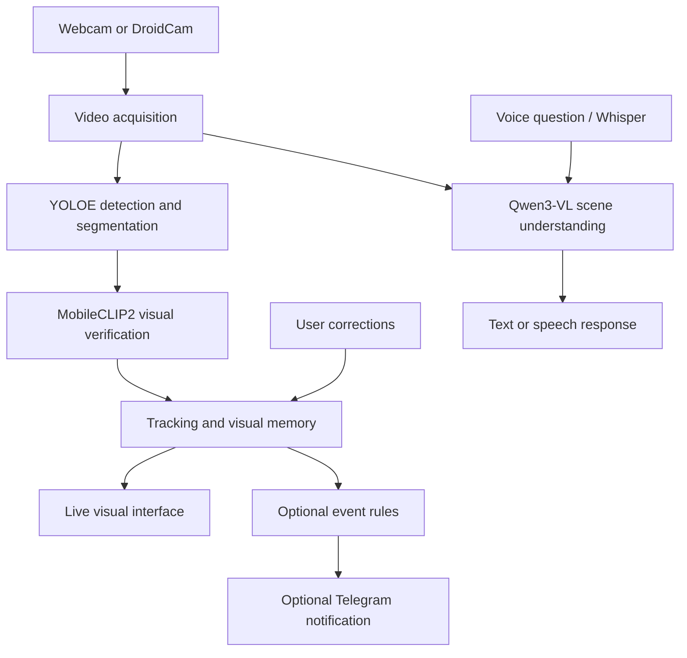

# VISION LIVE

**Experimental multimodal visual perception system**

Real-time object detection · Tracking · Visual memory · Scene understanding · Voice interaction

Developed by **Linze Lowe Christ Maxime (Christ Lowe)**.

[Portfolio / EN](https://christ-lowe-portfolio.vercel.app/en/work/computer-vision) · [Portfolio / FR](https://christ-lowe-portfolio.vercel.app/fr/projets/vision-par-ordinateur) · [Notebook](Vision_Live.ipynb) · [Model setup](docs/modeles.md)

---

## 01 / Research objective

Vision Live explores how a local AI system can perceive a changing visual scene, maintain object identities, incorporate user corrections and answer questions about what it sees. It is a research and engineering prototype, not a validated safety or security product.

The current implementation processes webcam or DroidCam video and supports French-language interaction.

## 02 / System architecture



Conceptual architecture based on the notebook's documented modules; not a benchmark or a formal execution trace.

## 03 / Technical components

| Component | Implementation | Purpose |
| --- | --- | --- |
| Open-vocabulary detection | YOLOE-11m | Locate and segment objects |
| Visual verification | MobileCLIP2 | Refine visual classifications |
| Temporal tracking | BoT-SORT and temporal stabilization | Maintain object identities across frames |
| Visual memory | User corrections and optional adapter training | Reuse corrected examples |
| Scene understanding | Qwen3-VL-4B | On-demand image descriptions and questions |
| Speech input | Whisper | Local speech recognition |
| Speech output | Kokoro or Piper | Spoken responses |
| Camera and display | OpenCV / PyAV | Video processing and interface |
| Compute | PyTorch / CUDA | Local accelerated inference |

Third-party pretrained models are used. The repository does not claim authorship of those models or demonstrate general autonomous learning.

## 04 / Getting started

The original environment uses Linux, Python 3.11, a Conda environment called `ai_master`, and a CUDA-compatible NVIDIA GPU.

The launcher currently expects the notebook at `~/Documents/Vision_Live/Vision_Live.ipynb`. On a fresh machine, clone into that location:

```bash
mkdir -p ~/Documents
git clone https://github.com/MaxScience-PowerAi/Vision-Live.git ~/Documents/Vision_Live
cd ~/Documents/Vision_Live
conda activate ai_master
```

The environment must already contain a compatible PyTorch/CUDA installation. Consult the installation cell in [Vision_Live.ipynb](Vision_Live.ipynb) for remaining dependencies, including Ultralytics, OpenCV, OpenCLIP, timm, PyAV, Transformers and bitsandbytes.

Download the required weights and caches into `~/Modeles_IA/` using the [model guide](docs/modeles.md). For Qwen, copy `outils/charger_qwen.py` into the shared model directory and use `bash telecharger_qwen.sh` from the project directory as documented.

Once the environment and weights are prepared:

```bash
python lancer_vision.py
```

Alternatively, use the notebook's quick-launch cell. The launcher enables offline Hugging Face and Transformers modes by default; prepare all required assets before running it.

| Key | Action |
| --- | --- |
| F | Text input |
| V | Voice question |
| I | Scene description |
| R | Screen recording |
| Q | Quit |

## 05 / Reproducibility and limitations

- The notebook is currently the main implementation source.
- A fully pinned dependency lockfile, portable setup, automated test suite and independent benchmark are future work.
- GPU memory usage and latency depend on hardware, model configuration and active modules.
- Confidence scores are model outputs, not measured system accuracy.
- Visual corrections and adapter training are not evidence of general continual-learning capability.
- This prototype must not be relied upon for safety-critical decisions.

See [model documentation](docs/modeles.md) for the original author's hardware observations. They are not independently reproduced benchmark results.

## 06 / Privacy and responsible use

Use cameras only where you have permission. Avoid recording or processing identifiable people without an appropriate lawful basis and consent where required. Do not publish personal captures, face data, event recordings, tokens or private datasets.

The default architecture uses local inference; optional Telegram notifications require network access and may transmit event information. Configure that feature only with appropriate safeguards.

Local captures, datasets, memory, logs, model weights and personal configuration are excluded by the repository's ignore rules. Never commit Telegram credentials; keep them in the local configuration described by the notebook.

## 07 / Licensing and third-party models

No project-wide license file has been identified at the repository root. Public visibility alone does not grant an open-source license. Review applicable licenses for the code, dependencies, pretrained weights and datasets before redistribution or commercial use.

---

<details>
<summary><strong>Présentation et démarrage en français</strong></summary>

Vision Live est un prototype expérimental de perception visuelle multimodale. Il analyse une webcam ou un iPhone via DroidCam, détecte et suit les objets, réutilise les corrections de l'utilisateur et peut répondre en français à des questions sur la scène.

La configuration originale utilise Linux, Python 3.11, Conda (`ai_master`) et un GPU NVIDIA compatible CUDA. Clone le projet dans `~/Documents/Vision_Live`, prépare les dépendances du notebook et les poids selon [le guide des modèles](docs/modeles.md), puis lance `python lancer_vision.py` dans l'environnement préparé.

Les touches F, V, I, R et Q ouvrent respectivement la saisie texte, la commande vocale, la description, l'enregistrement et la fermeture. Les modèles et données personnelles restent locaux par défaut; les alertes Telegram facultatives nécessitent Internet.

Ce projet reste expérimental. Les performances, la reproductibilité et les conditions de licence restent à documenter davantage.

</details>

**From mathematics to intelligence.**
